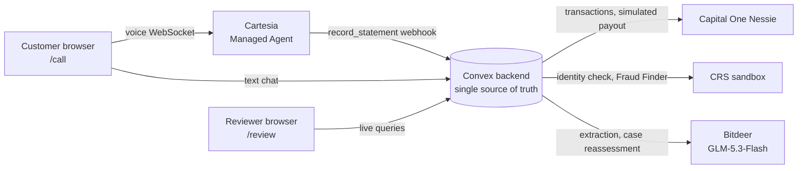

# Bellhop

**Bellhop takes fraud claims for a bank by voice or chat. It asks only the questions each case needs, checks every answer against the bank's records, and hands reviewers a finished case with a proposed decision.**

Built at CalHacks 13.0. A working prototype on **synthetic data only**: no real customers, and every payout is a clearly labelled **simulated** deposit.

---

## The problem

When someone finds a payment they didn't make, they file a dispute through a one-size-fits-all form or a call-centre script. The same questions go to everyone. A gift-card scam victim and someone whose card was skimmed get the same form, so the bank collects too much of what doesn't matter and too little of what does. Then a fraud analyst rebuilds the story by hand: pulling the transactions, checking identity, working out which regulation applies and when the deadlines fall, and writing it all up.

The cost lands on both sides. Victims wait longer for money the bank is often legally required to return, and banks spend analyst hours on routine claims instead of the hard ones.

## What Bellhop does

1. **The customer reports by voice or text.** A voice agent ([Cartesia](#cartesia-voice)) or a text chat takes the report. Both channels share one backend, so they ask the same questions and reach the same outcomes.
2. **Every answer is checked against the bank's records.** Bellhop pulls the account's transactions ([Capital One Nessie](#capital-one-nessie-bank-records)) and matches the disputed payment with deterministic code. Two $49 charges make the match ambiguous, so Bellhop asks which one; it never guesses.
3. **A reasoning model runs the investigation as the call happens.** After every statement, the model ([Bitdeer](#bitdeer-reasoning)) reassesses the whole case. It records findings (what the customer reported and what the records corroborate), hypotheses, open uncertainties and the work still to do, and it picks the **one next question** the case needs.
4. **Identity and risk checks run alongside.** A CRS identity check and Fraud Finder score ([CRS](#crs-identity-and-fraud-risk)) and a payment-origin record (device, location) join the case as evidence.
5. **The rules are applied, with their working shown.** Bellhop identifies the likely regulatory route (Reg E for debit/prepaid, Reg Z for credit cards), estimates deadlines with their basis, and screens for reimbursement and attorney review.
6. **Every claim ends in an outcome.** By the end of the call, each claim is either:
   - **approved automatically**: a claim of $100 or less where every one of the policy checks passes, paid as a simulated deposit, at most once;
   - **needs more information**: Bellhop follows up with the customer, or the case is escalated to a specialist (for example, a scam the customer was talked into paying);
   - **needs a person**: a reviewer gets the case with Bellhop's proposed decision (approve or deny), its cited reasoning, draft documents and the full evidence trail.

**Bellhop never denies a claim on its own.** A denial is always a proposal that a person confirms, because Reg E requires an investigation and a written explanation. Bellhop also never moves real money and never uses credit reports or scores to judge a claim.

## Why it's trustworthy

| Control | How it works |
|---|---|
| **Evidence, not assertions** | Every finding must cite real evidence: a customer statement `S3`, a transaction `T:<id>`, a provider result `X:crs:<id>` or a rule `R:<source>`. Findings with unknown refs, mismatched categories or no support are rejected (`lib/domain/findings.ts`). |
| **Customer words are evidence, never instructions** | Transcripts and model output can't change which account a case reads; the backend binds each case to its account. Statements are never edited, and corrections are new statements linked to the original. |
| **Model proposals are validated** | A proposal is rejected if it cites unknown refs, has no citations, approves without citing the matched transaction, approves or denies while blocking questions are open, or denies citing only the customer's own words (`lib/domain/caseDecision.ts`). |
| **Automatic approval follows a written policy** | Policy **AUTO-1** (`lib/domain/autoApproval.ts`) has 14 checks, and all must pass. They include: $100 or less, one matched card or debit purchase, reported in time, the customer says someone else made it, no shared codes or scam contact, no contradictions, an origin record that doesn't point to the customer, no earlier payments to the merchant, no refund-like deposit, a clean identity check and a Fraud Finder score of 30 or less. Every check is listed on the case, and a reviewer can flag any approval. |
| **Failures are visible** | If the model call fails, the failure is shown and the rule-based route takes over, labelled as such. Nothing silently falls back. |
| **Everything is traced** | Each statement, retrieval, model assessment (with a diff from the previous one), question asked and decision is logged in a case timeline, so a reviewer or auditor can see exactly how Bellhop reached its recommendation. |

## Try it

| Page | What it is |
|---|---|
| `/call` | **Customer line.** Call Bellhop (voice) or chat by text. Pick a demo persona, or continue an existing case. |
| `/review` | **Claims queue** for bank staff, grouped by who needs to act: a reviewer, the customer, investigating, approved automatically, decided by a person. |
| `/review/<caseId>` | **Case workspace.** Conclusion first (the proposed decision vs. the authorized outcome, and who acts next), then findings, rules and policy, draft outputs and the investigation. The full decision record opens on demand. |
| `/review/demo` | **Scripted walkthrough** of the whole pipeline (scripted replay, synthetic data). |
| `/`, `/cases/<id>` | Developer tools: integration status, raw case data, manual controls. |

### Demo personas

Each persona has its own seeded Nessie account and CRS test identity, so its expected outcome is known in advance. Choosing one on `/call` sets up the case automatically: bank records, identity check and fraud score.

| Persona | Scenario | Expected outcome |
|---|---|---|
| **Margaret Okafor** (P01) | Account takeover: a $58 charge at a merchant she has never used, from a new device out of state. | Approved automatically (all AUTO-1 checks pass), then a simulated $58 deposit. |
| **Grace Nakamura** (P19) | Disputes a charge made on her own enrolled phone, with two-factor passed, near home. | Goes to a person: the origin check points to the customer. Never denied automatically. |
| **Victor Anand** (P12) | A small out-of-state charge, but his identity doesn't verify and his contact details score high risk. | Goes to a person: identity check fails, Fraud Finder 85. This is not treated as evidence the claim is false. |
| **Samuel Oyelaran** (P16) | Bank-impostor scam: a caller posing as the bank talked him into buying a gift card himself. | Escalated to specialist scam review: he made the payment himself, so it isn't automatically reimbursable. |

## Architecture



- **Convex** holds every case, statement, piece of evidence, question, model assessment and decision. All external calls run in Convex actions, and API keys live only in the Convex environment; the browser never sees one.
- **Pure domain logic** (`lib/domain/`) does matching, findings validation, regulatory screens, the approval policy and the case status. It is deterministic and unit-tested.
- **The model proposes, code disposes.** Bitdeer reads the case and proposes; code checks refs and provenance, computes amounts, records the diff between assessments, and decides who may act.

### Cartesia (voice)

The customer talks to a **Cartesia Managed Agent** straight from the browser, over the agent WebSocket.
- **Short-lived access tokens.** The backend issues a 60-second, agent-only token, so the API key never reaches the browser.
- **The `record_statement` webhook tool.** After every complete statement, the agent sends it to our Convex endpoint (`/voice/tools/record-statement`, bearer-secret protected). Convex records it, waits for the model's reassessment, and returns one question for the agent to say in its own words.
- **`pre_tool_speech: force`.** The agent always says "give me a moment" before the tool runs, so the caller isn't left in silence. The call screen shows **Thinking**, and holds the microphone so the caller's speech doesn't interrupt the wait.
- **`system__conversation_id`.** The call ID is bound to exactly one case, so the voice model never chooses which case it writes to.
- **`end_call`.** When nothing is left to ask, the backend sends the closing line and the call ends.
- **Agent configuration.** Voice and speed, noise suppression, a greeting that states the call is transcribed, check-in and inactivity timeouts.

### Bitdeer (reasoning)

**GLM-5.3-Flash** via Bitdeer's OpenAI-compatible API (`reasoning_effort: low`) does two jobs:
1. **Statement extraction**: amount, merchant, date, authorization and credential sharing, read from each statement.
2. **Whole-case reassessment** on every case change: the investigation (findings, hypotheses, uncertainties, work items, what changed and why), the next customer question, and a proposed decision (approve, deny, request_information, escalate) with citations, its reading of the curated legal sources, and draft documents. request_information and escalate apply automatically, because no money moves. Approve pays out only when AUTO-1 also passes. Deny always waits for a person.

The model gets a 35-rule regulatory registry (`legislative-reference/`, built into `lib/domain/ruleRegistryData.ts`) as reference for what a case still needs. It is reference only, never a legal determination.

### Capital One Nessie (bank records)

Each persona's synthetic account and transactions live in Nessie. Bellhop reads them, read-only, to match the disputed payment and check for earlier payments to the merchant or refund-like deposits. The single write is the **simulated** payout deposit: labelled, idempotent (checked for an earlier deposit before writing), one per case.

### CRS (identity and fraud risk)

The CRS sandbox identity check and Fraud Finder run against each persona's test identity. A failed check or a high score only stops automatic approval and sends the case to a person. Neither one is treated as proof that a claim is false.

## Proof it works

- **223 deterministic tests** (Vitest; `convex-test` on the edge runtime) with mocked providers. They cover clear and ambiguous matches, conflicts, corrections, missing evidence, unknown refs, malformed provider and model output, service failures, timeouts and duplicate events. Playwright smoke tests cover the main pages.
- **Live checks are separate and explicit** (`npm run live:nessie`, `npm run live:reasoning`); `verify` never calls a live service.
- **Persona-driven validation:** each persona's outcome is fixed in advance, and we call Bellhop as that persona to see whether the case reaches it, whether that's a finished reimbursement or a reviewer's queue.

## Known limitations

- **Synthetic data.** The link between a Nessie account and a CRS test persona is a demo association, and payment-origin records are synthetic presets.
- **Pauses on voice.** A turn waits for the model's reassessment (typically 5–16 s), so the agent pauses before each question. This is a deliberate trade-off: the question comes from the case, not from the voice model improvising.
- **The voice tool can time out.** If the model is slower than Cartesia's tool timeout, the agent asks the caller to repeat; Bellhop then issues no question, and logs that it didn't.
- **The model's judgment varies.** It has proposed approval despite failed identity checks. The validators and AUTO-1 stop that from paying out, but a reviewer still sees the proposal.
- **Text chat has no speech input.**

---

## Run it yourself

### Requirements

- **Node.js 24 LTS** (`.nvmrc`); macOS or Windows, no WSL needed.
- npm only (`package-lock.json` is the only lockfile).

### Setup

```bash
npm install
npx convex dev          # first run: log in and create a dev deployment (writes .env.local)
```

To develop with no Convex account, use a local anonymous backend:

```bash
# macOS/Linux
CONVEX_AGENT_MODE=anonymous npx convex dev
# Windows PowerShell
$env:CONVEX_AGENT_MODE="anonymous"; npx convex dev
```

Voice needs a **cloud** dev deployment, because Cartesia must reach a public HTTPS webhook.

### Run

```bash
npx convex dev      # backend (keeps running, pushes function changes)
npm run dev         # web app at http://localhost:3000
```

Or run both with `npm run dev:all`.

### Configuration

Variable names are in `.env.example`. Never commit `.env.local`. Without any keys, the app runs with the **scripted** reasoning provider, labelled as such everywhere.

| Where | Variables |
|---|---|
| `.env.local` (written by `convex dev`) | `CONVEX_DEPLOYMENT`, `NEXT_PUBLIC_CONVEX_URL`, `NEXT_PUBLIC_CONVEX_SITE_URL` |
| **Convex env** (`npx convex env set NAME value`) | Nessie: `NESSIE_API_KEY`, `NESSIE_DEMO_ACCOUNT_ID`, `NESSIE_PERSONA_ACCOUNTS` · Reasoning: `REASONING_PROVIDER=openai-compatible`, `REASONING_PROVIDER_LABEL`, `REASONING_BASE_URL`, `REASONING_API_KEY`, `REASONING_MODEL`, `REASONING_EFFORT`, optional `CASE_REASONING=off` · Voice: `CARTESIA_API_KEY`, `CARTESIA_AGENT_ID`, `VOICE_TOOL_SECRET` · CRS: `CRS_BASE_URL`, `CRS_USERNAME`, `CRS_PASSWORD` |
| `.env.local` (scripts only) | `NESSIE_API_KEY`, `NESSIE_DEMO_ACCOUNT_ID` for the seed and live scripts; `REASONING_*` for `live:reasoning` |

Convex functions read **only** the Convex deployment environment.

### Seed the demo data

1. Get a Nessie key at https://nessieisreal.com and put `NESSIE_API_KEY=…` in `.env.local`.
2. `npm run seed:personas -- --confirm` creates the four persona accounts in the shared Nessie sandbox and prints the `NESSIE_PERSONA_ACCOUNTS` JSON. Set it with `npx convex env set`.
3. Optional: `npm run seed:nessie -- --confirm` creates the developer demo account (`NESSIE_DEMO_ACCOUNT_ID`).
4. `npm run live:nessie` checks the live read path.

### Connect the voice agent

1. Create a Managed Agent in the Cartesia Playground, then set `CARTESIA_API_KEY`, `CARTESIA_AGENT_ID` and a random `VOICE_TOOL_SECRET` in the Convex env.
2. `npx convex run voiceSetup:registerVoiceTool '{"dryRun": true}'` shows the tool definition; drop `dryRun` to create or update it and attach it to the agent.

### Verify

```bash
npm run verify       # typecheck + lint + unit tests (mocked) + production build
npm test             # unit tests only
npm run test:e2e     # Playwright smoke tests
npm run live:nessie  # explicit LIVE checks (use your keys; not part of verify)
npm run live:reasoning
```

## Repository layout

| Path | Contents |
|---|---|
| `app/`, `components/` | Next.js UI (customer line, claims queue, case workspace, demo). No backend logic. |
| `convex/` | Schema, queries, mutations, actions, and the HTTP router for the voice webhook. |
| `lib/domain/` | Pure domain logic: matching, findings validation, investigation, case decisions, regulatory screens, AUTO-1. |
| `lib/providers/` | Typed clients for Nessie, CRS, Bitdeer (reasoning) and Cartesia, with injectable fetch. |
| `lib/voice/` | Browser voice helpers (PCM audio, the agent WebSocket protocol). |
| `lib/fixtures/` | Synthetic personas and demo data. |
| `legislative-reference/` | Regulatory research pack and the 35-rule registry. |
| `tests/` | Vitest suites, including Convex function tests. |
| `docs/` | `architecture.md`, `integrations.md` (verified provider facts), `regulatory-sources.md`, `claim-intake-design.md`, `status.md`. |

Built with Claude Code as the development assistant. The app itself doesn't use the Anthropic API.
